<p align="center">
  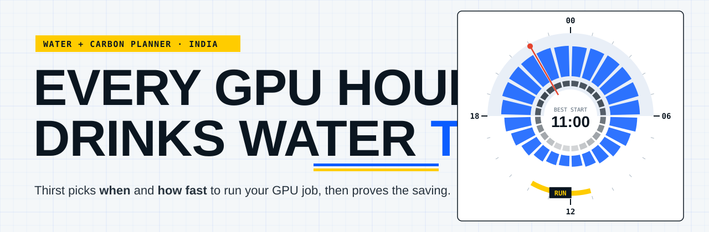
</p>

<p align="center">
  <a href="https://github.com/Neal006/Thirst/actions/workflows/ci.yml"></a>
  
  
  
  <a href="https://pypi.org/project/thirst/"></a>
  <a href="https://main.dzxkrtlc7xqfx.amplifyapp.com"></a>
</p>

<h3 align="center">Run your GPU job at the right hour and the right speed.<br>Take less water from India's thirstiest cities. Prove it with a receipt.</h3>

---

## Why this exists

Training an AI model on a GPU uses electricity. That electricity uses **water twice**: once at the power plant that makes it, and once at the building that carries the heat away. In Chennai, Delhi or Bengaluru, that water is already scarce.

<p align="center">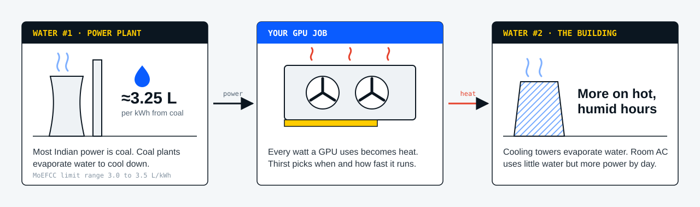</p>

Nobody running a 6-hour training job sees this. Thirst makes it visible, gives you a better plan, and rewards labs that follow it.

---

## What you get

<table>
  <tr>
    <td width="50%" valign="top">
      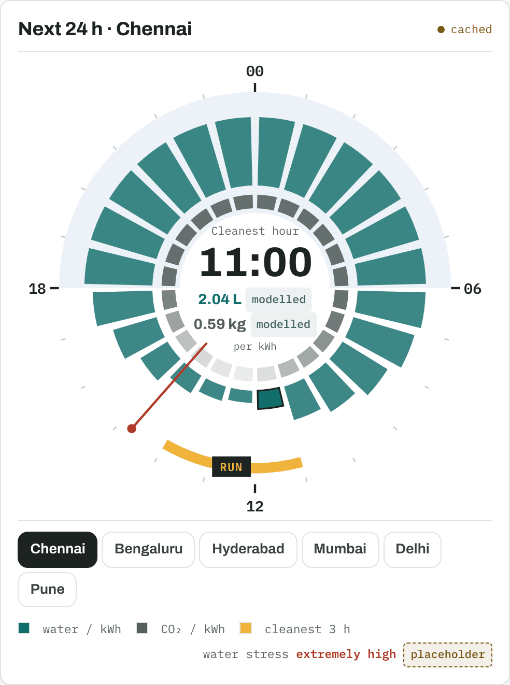
      <p><b>🕒 The water clock</b><br>Your city's next 24 hours on one dial. Longer teal wedges mean thirstier hours. The amber <b>RUN</b> arc is the best window.</p>
    </td>
    <td width="50%" valign="top">
      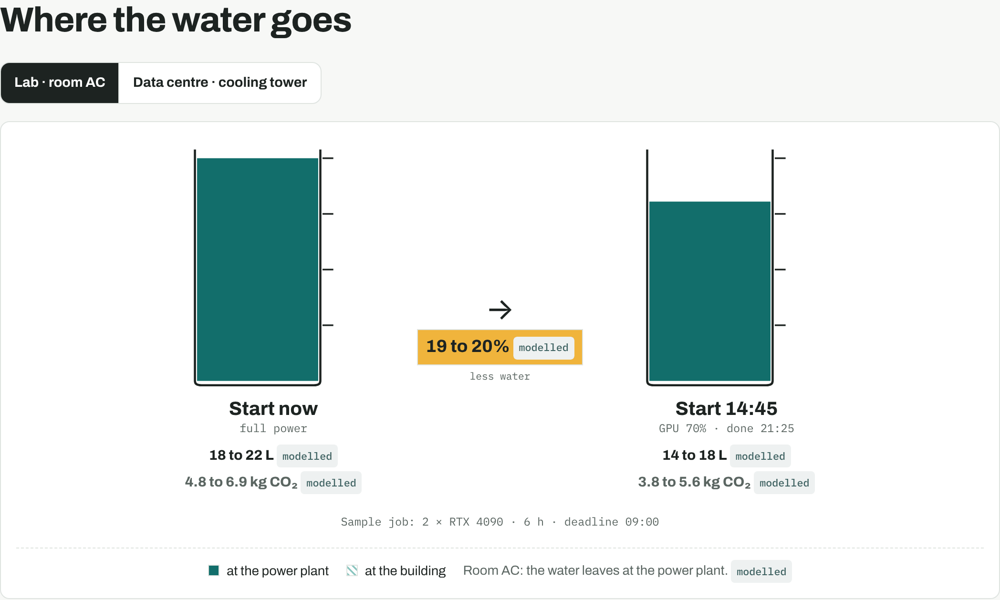
      <p><b>🧪 Same job, two start times</b><br>Start now vs start on the plan, side by side, with the water split into power-plant water and building water.</p>
    </td>
  </tr>
  <tr>
    <td valign="top">
      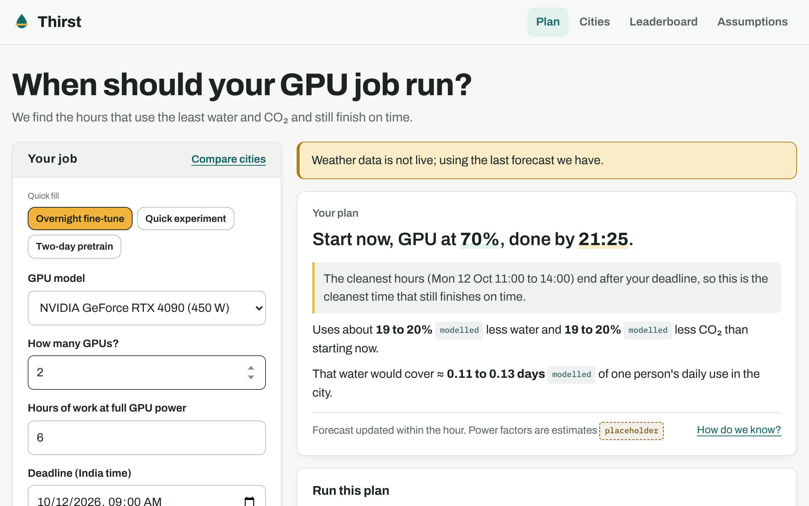
      <p><b>📋 One sentence, one plan</b><br><i>"Start at 02:00, GPU at 70%, done by 08:40."</i> One line says why that time. Read the next 48 hours as a timetable, an hourly list, a calendar or a chart.</p>
    </td>
    <td valign="top">
      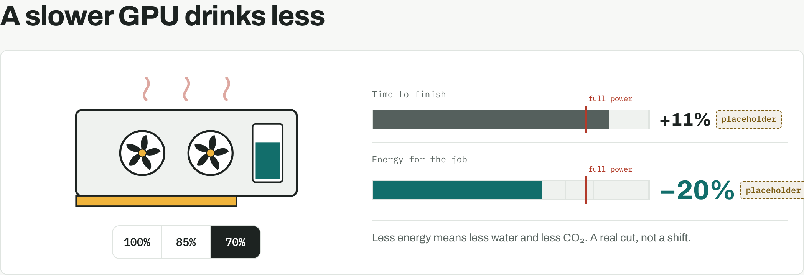
      <p><b>🎚️ The speed knob</b><br>A GPU at 70% power takes a little longer and uses noticeably less energy. That is a real cut, not just a shift.</p>
    </td>
  </tr>
  <tr>
    <td valign="top">
      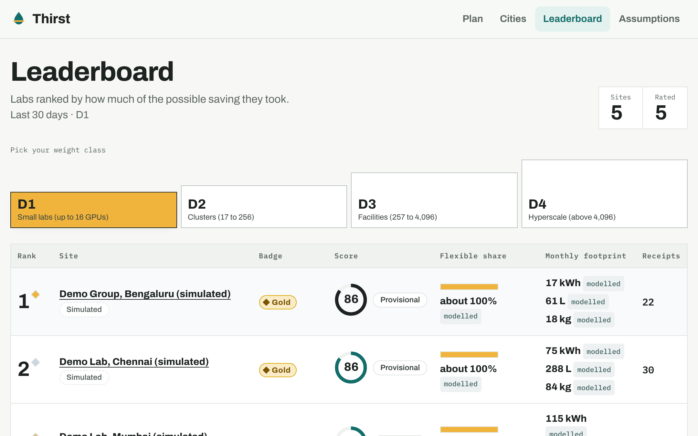
      <p><b>🏆 Leaderboard by weight class</b><br>A 4-GPU college lab only competes with other small labs, never with a data centre.</p>
    </td>
    <td valign="top">
      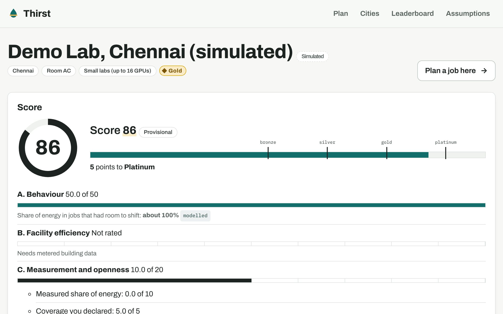
      <p><b>🥇 Your lab's score</b><br>A 0 to 100 score, a badge, and how many points to the next one.</p>
    </td>
  </tr>
  <tr>
    <td valign="top">
      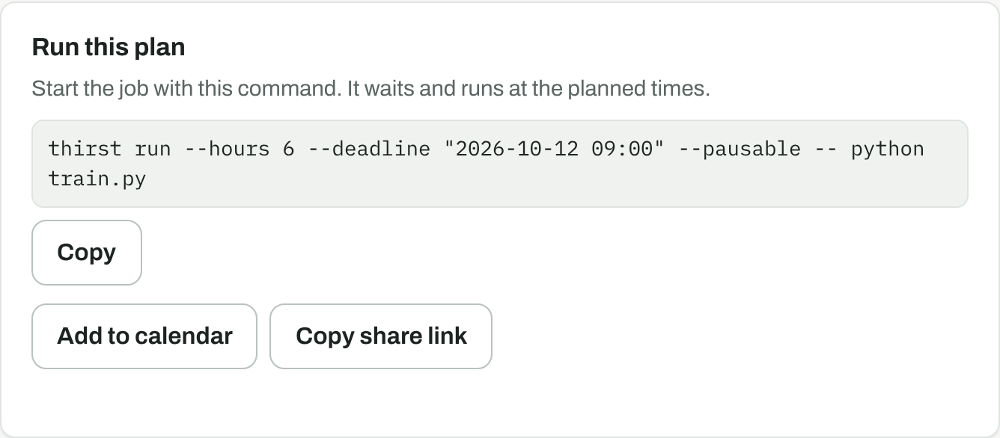
      <p><b>▶️ Run it, schedule it, share it</b><br>Copy the exact <code>thirst run</code> command, add the run to your calendar with a reminder, or send a link that reopens the same job. Your last five plans stay one click away.</p>
    </td>
    <td valign="top">
      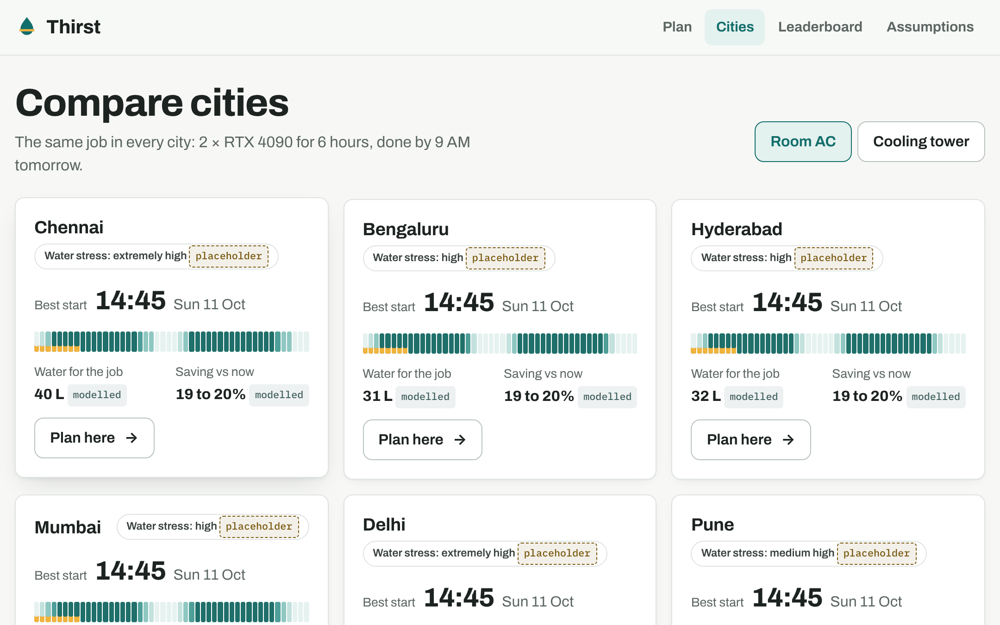
      <p><b>🗺️ Compare cities</b><br>The same job in six Indian cities: best start, a 48-hour strip, water for the job and the saving, with room AC or a cooling tower.</p>
    </td>
  </tr>
</table>

---

## How it works

<p align="center">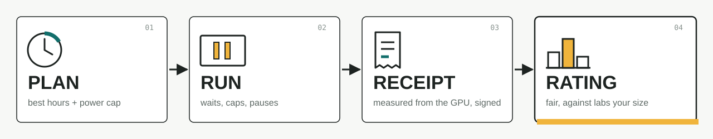</p>

| Step | What happens | Who does the work |
|---|---|---|
| **1 · Plan** | You say: GPU, how many, hours of work, deadline, city. Thirst finds the start time, pauses and power cap that use the least water and CO₂ and still beat your deadline. | The planner (plain maths, no AI guessing) |
| **2 · Run** | `thirst run` waits for the right hour, lowers the GPU power limit, runs your script, pauses and resumes it if planned, and **always puts the power limit back**, even if you press Ctrl-C. | The CLI on your GPU machine |
| **3 · Receipt** | When the job ends you get a signed receipt: energy **measured** from the GPU, water and CO₂ **modelled** from it, compared with "if you had started right away". | The CLI + the API |
| **4 · Rating** | Receipts add up to your lab's score on the public board. | The API |

---

## Try it

### On the web

Open the site, pick your city, and look at the water clock. Then press **Plan a job**.

> 🌐 **Live:** **https://main.dzxkrtlc7xqfx.amplifyapp.com**

### On your GPU machine

```bash
pip install thirst

thirst register --name "CSE GPU Lab" --city Chennai --cooling room_ac --gpus 4
thirst run --hours 6 --deadline "2026-10-12 09:00" --pausable -- python train.py
```

That's it. Thirst waits, runs, measures, and prints your receipt:

```text
Thirst receipt j_tksft2nswiku
  Ran      11 Oct 02:00 to 08:40 IST on 2 x NVIDIA GeForce RTX 4090, cap 70%
  Energy   3.89 kWh GPU (measured)
  Water    16.5 L (modelled); if you had started right away: 21.0 L
  Carbon   4.81 kg CO2 (modelled); if you had started right away: 6.12 kg
  Capture  You took 86% of the possible saving
  Score    Site score 82 (Provisional)
```

<sub>Example layout. Your numbers come from your GPU and the planner.</sub>

| Useful flags | |
|---|---|
| `thirst plan …` | See the plan without running anything |
| `thirst run --now …` | Start right away (still measured, still a receipt) |
| `thirst run --modelled …` | Thirst estimates the energy and says so on the receipt. With no NVIDIA GPU, add `--gpu-model` and `--gpus` (ids are on the Assumptions page) |
| `thirst doctor` | Checks your setup: GPU, power-cap permission, clock, API |

---

## What Thirst can honestly change

| Lever | What it does | Real cut or a shift? |
|---|---|---|
| 🎚️ **Slow the GPU a little** | Lower the power limit, so the same work uses less energy | ✅ **Real cut**: less energy means less water and CO₂ |
| 🕒 **Pick better hours** | Run when each kWh costs less water and CO₂ | ↔️ **Mostly a shift**. It becomes a real cut when it uses midday solar that would otherwise go to waste |
| 🧾 **Receipt + rating** | Make the cost visible and reward good choices | 📈 **Behaviour change** over months, across many labs |

We never claim to "reverse" water use. We show ranges, not single numbers.

---

## A fair score

Your score asks one question: *of the saving that was possible for this job, how much did you actually take?*

```text
                 1 − J(actual)
   Capture  =  ─────────────────       J = a mix of water, CO₂ and energy, compared with "start now"
                 1 − J(best)
```

- **Score the choice, not the climate.** A lab next to a coal plant and a lab next to a dam each start from their own "start now" baseline, so both can score high.
- **Weight classes**, like boxing:

| Class | Size | |
|---|---|---|
| **D1** | Small labs, up to 16 GPUs | 🎓 College labs live here |
| **D2** | Clusters, 17 to 256 | |
| **D3** | Facilities, 257 to 4,096 | |
| **D4** | Hyperscale, above 4,096 | |

- **Badges:** 🥉 Bronze 45+ · 🥈 Silver 60+ · 🥇 Gold 75+ · 💎 Platinum 90+
- **No gaming it:** the start time comes from the server, receipts are signed, energy above what your GPUs can draw is rejected, and urgent jobs with no room to shift are left out instead of punished.

---

## Every number wears a label

| Label | Meaning |
|---|---|
|  | Read from the hardware on your machine |
|  | Calculated from a model; the Assumptions page shows how |
|  | Taken from a published source we cite |
|  | Adjusted so the model matches a published yearly figure |
|  | A stand-in until we measure the real value |

Click any label in the app to see its value, its range and its source.

<p align="center">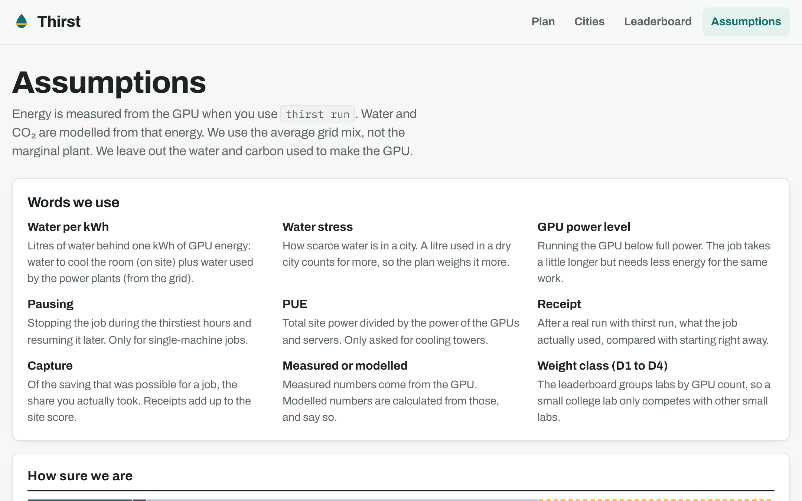</p>

---

## Questions

<details>
<summary><b>Do I need an NVIDIA GPU?</b></summary>
No. Use <code>--modelled --gpu-model RTX-4090 --gpus 1</code> (any id from the Assumptions page) and Thirst estimates the energy from that GPU model. The receipt says "modelled" and doesn't earn measurement points.
</details>

<details>
<summary><b>Will it break my training run?</b></summary>
Thirst only lowers the power limit and pauses or resumes your process. It always restores the power limit at the end, on Ctrl-C, and if something crashes. If it can't change the limit (laptops often block it), the job runs normally and the receipt says "uncapped".
</details>

<details>
<summary><b>Can every job pause?</b></summary>
Single-process training can. Multi-GPU distributed jobs (<code>torchrun</code>, DeepSpeed, MPI) and Windows run without pauses, and Thirst says so.
</details>

<details>
<summary><b>What do you collect?</b></summary>
A lab name (shown publicly), city, cooling type and GPU count, plus per-hour energy from each receipt. No personal data. You can keep a site off the board with <code>--private</code>.
</details>

<details>
<summary><b>Where does the AI come in?</b></summary>
The maths solver makes every decision. An optional AI (Amazon Bedrock with Strands Agents) only explains the plan in plain words, and its answer is rejected if it invents a number.
</details>

---

## Built on AWS

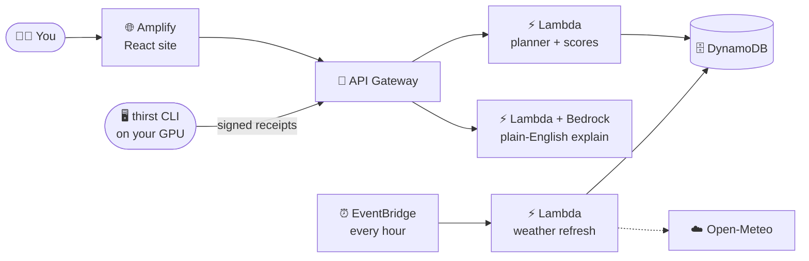

Amplify · API Gateway · Lambda · DynamoDB · EventBridge Scheduler · Bedrock + Strands Agents · SAM. No servers to babysit, and no GPUs on AWS.

---

## For developers

Python 3.12, Node 22.12+.

```bash
uv venv --python 3.12 .venv && uv pip install -e ".[dev]" -e ./cli
npm --prefix web ci

python scripts/local_api.py                                  # real API on :3000, in-memory DB, live weather
cd web && VITE_API_URL=http://127.0.0.1:3000 npm run dev      # site on :5173
```

Deploys run from GitHub Actions after CI passes on `main` (`.github/workflows/deploy.yml`, AWS access through OIDC, no stored keys). By hand: `python scripts/build_layer.py && sam build && sam deploy --profile thirst`, then `python scripts/deploy_web.py --app-id dzxkrtlc7xqfx --api-url <ApiUrl> --profile thirst`.

Checks: `make check` (or the commands in the [`Makefile`](Makefile) on Windows) and `npm --prefix web test -- --run`.
Try it end to end: [`docs/USER_TEST_GUIDE.md`](docs/USER_TEST_GUIDE.md) · what's left: [`docs/TODO.md`](docs/TODO.md).
Deep dives: [`Idea.md`](Idea.md) (why) · [`prd.md`](prd.md) (what) · [`trd.md`](trd.md) (how) · [`docs/implementation-plan/`](docs/implementation-plan/README.md) · [`AGENTS.md`](AGENTS.md).

---

## AI tools used

- **Claude Code** (Anthropic; Claude Opus and Claude Sonnet models) helped plan, write, test and review the code, and set up AWS and CI. Commits it helped write carry a `Co-Authored-By: Claude …` trailer.
- **Amazon Bedrock + Strands Agents** inside the product only explain a plan in plain words. The solver makes every decision.

The full writeup, with how each AWS service is used and the limits we know about, is in [`docs/WRITEUP.md`](docs/WRITEUP.md).

---

## Credits

Weather by **[Open-Meteo](https://open-meteo.com)** (CC BY 4.0) · grid CO₂ factor from **CEA** · coal water limits from **MoEFCC** · water stress from **WRI Aqueduct** · city water norm from **CPHEEO** · national generation mix from the **CSEP** Electricity and Carbon Tracker.

Built for **Environmental Hacks (WeMakeDevs × AWS)** by team **hello_world**. MIT licence, see [`LICENSE`](LICENSE).
