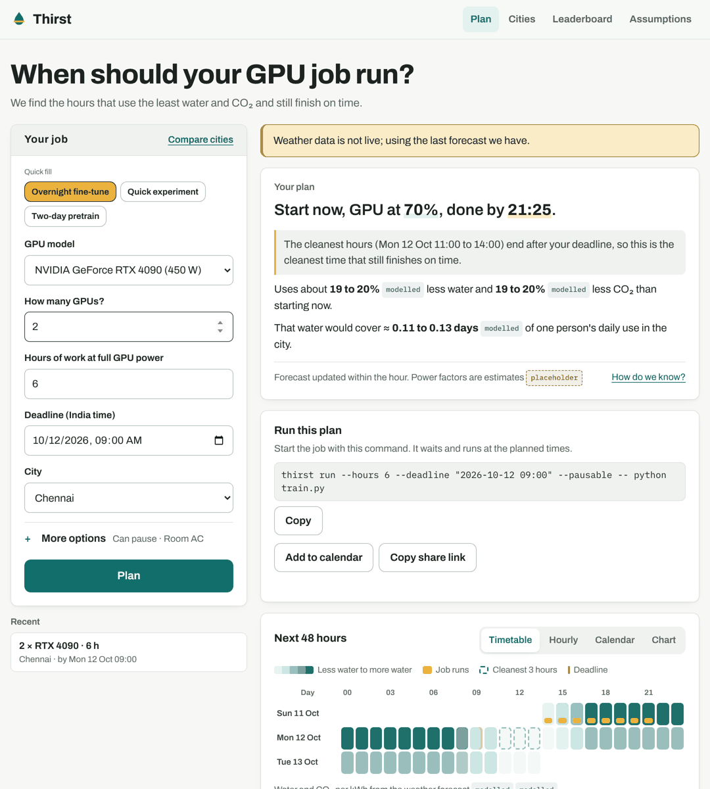
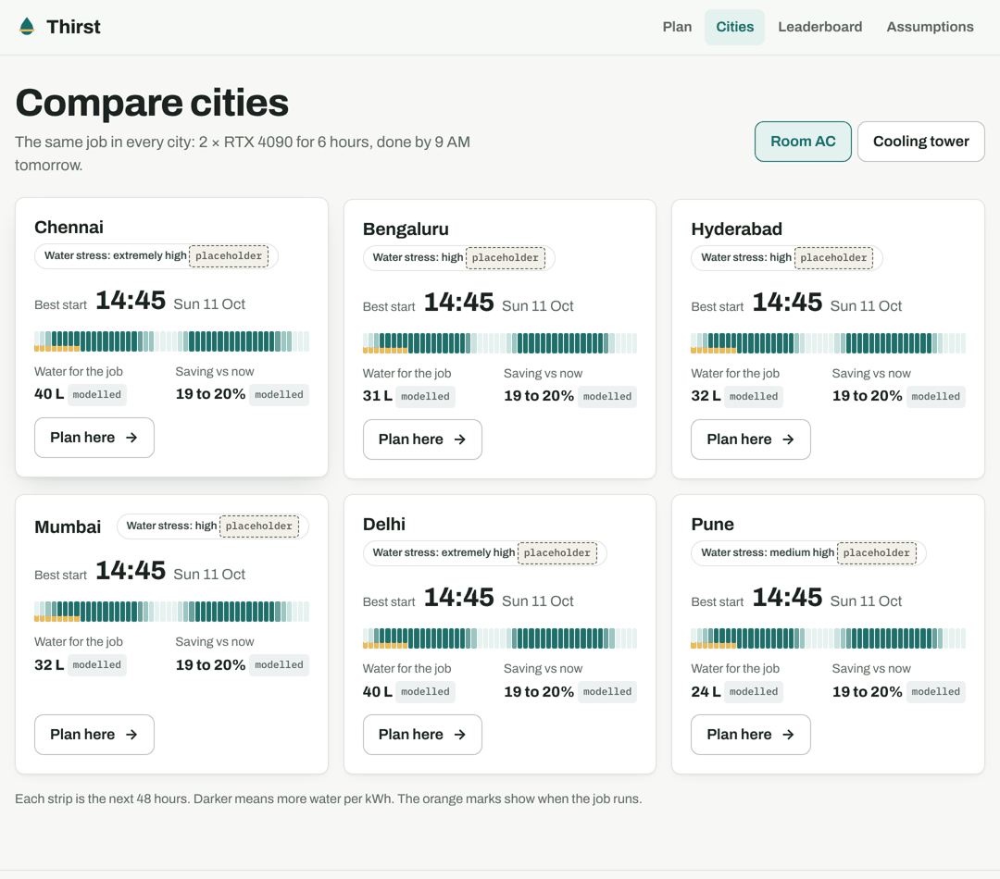
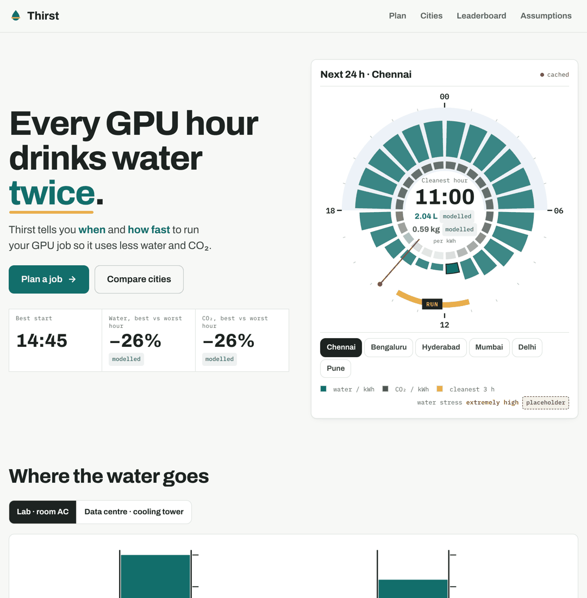
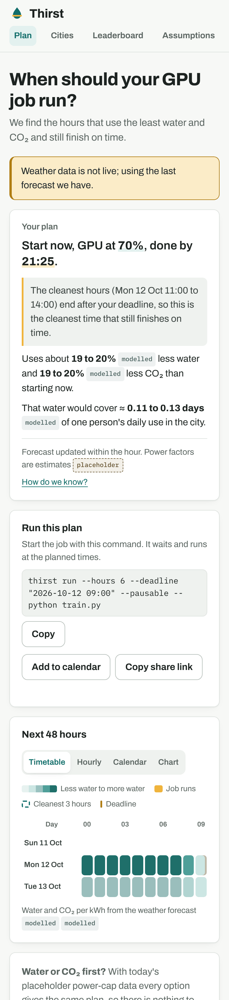

# UX overhaul: plan views, plan actions, Cities page, Monsoon theme, and the CLI walkthrough fixes

**Branch:** `feat/web-ui-accessibility` → `main`
**Plan:** [`docs/implementation-plan/09-ux-overhaul.md`](../implementation-plan/09-ux-overhaul.md) · **Hand test:** [`manual-test-checklist.md`](manual-test-checklist.md)
**Touches:** `web/` (UI, unit tests, e2e), `cli/` (six small output fixes from `docs/TODO.md` 4.1, one security fix from 4.2), docs. No API, engine, infrastructure or deploy workflow changes.

> **Merging deploys.** `main` auto-deploys the site. If the demo video is recorded before this merges, record it on the current live site and keep the old wording (see the note at the top of `docs/VIDEO_SCRIPT.md`). After merging, run the e2e suite once against the live site (TODO 5.8).
>
> **Before merging, merge `main` into this branch.** `main` has PR #12 (CLI 0.3.1 release workflow) since this branch last merged. It touches `cli/pyproject.toml`, `cli/thirst/__init__.py` and a new workflow, none of which this branch changes, so no conflict is expected.

## Summary

A user test showed that people could get a plan but did not understand all of it, and then had nothing to do with it. This PR:

1. **Fixes the 16 user-test problems** and adds small, connected features: four views of the plan, a "Run this plan" box (command, calendar file, share link), recent plans, a Cities page and a glossary.
2. **Reviews the merge of PR #11** and fixes what the merge and `main`'s new e2e + axe suite found: contrast on the softer label chips, a focus problem in the timetable, a broken phone menu, and names that the e2e, video and README depend on.
3. **Works through the new docs.** The CLI walkthrough problems in `TODO.md` 4.1.a–f are fixed with tests. TODO 5.4, 5.6 and 5.7 are done. `USER_TEST_GUIDE.md` and `VIDEO_SCRIPT.md` now describe the new screens.

The site now reads as one product: **Home → Plan → run it, schedule it, share it, or compare cities → Leaderboard → Site → Receipt → plan again.**

| Plan page | Cities page |
|---|---|
|  |  |

| Home | Plan on a phone |
|---|---|
|  |  |

---

## 1. User-test problems solved

| # | What users ran into | What this PR does |
|---|---|---|
| 1 | Home sections stayed blank until you scrolled past them | Visible by default. The scroll effect only lifts them a few pixels |
| 2 | Home said "best start 11:00" while the sample job started at 02:00 | **Best start** now shows the sample job's planned start (it matches the beaker). The clock centre says **Cleanest hour** |
| 3 | The plan skipped the cleanest hours and never said why | A "why this time" line under the plan |
| 4 | Jargon: stress-weighted, person-days, PUE, the Capture formula | Plain words in the UI. A glossary (`/assumptions#glossary`) explains the words we keep: Capture, weight class, PUE |
| 5 | Nine form fields before anything happened | Quick fill first. Pausing, cooling and PUE are under "More options", which shows the current choice |
| 6 | Chart axis labels overlapped | Fewer ticks, shorter labels |
| 7 | The trade-off slider did nothing (placeholder data makes all 11 options the same plan) | Hidden while the options are identical, with one line saying why and a `placeholder` chip (TODO 5.7) |
| 8 | Label chips cluttered every line | Smaller and softer, still on every number, still ≥ 4.5:1 contrast |
| 9 | All caps, graph paper, cobalt and yellow competed for attention | Monsoon palette, sentence case, plain background, soft shadows |
| 10 | Long site names wrapped into a huge heading | Smaller site heading |
| 11 | City buttons overflowed on a phone | They wrap |
| 12 | Empty weight classes looked broken | A short message and a "Plan your first job" button |
| 13 | Small print users did not need | Removed the footer AWS and data lists and the label legend on home. One footer line keeps "How do we know?" |
| 14 | No way to act on a plan | "Run this plan": copy command, add to calendar, copy share link |
| 15 | No way to compare cities | `/cities` |
| 16 | Pages felt like separate demos | Every page links to a next step |

## 2. New features

All use data the app already fetches. No backend change.

| Feature | Where | Notes |
|---|---|---|
| **Plan views**: Timetable (default), Hourly, Calendar, Chart | `PlanViews.tsx`, `lib/planViews.ts` | Same 48 hours, four ways to read them. Arrow keys move between tabs. The last tab is remembered in this browser |
| **Run this plan** | `PlanActions.tsx` | The exact `thirst run --hours … --deadline "…" [--pausable] -- python train.py`, a `.ics` event with a 10 minute reminder, a share link |
| **Share links** | `PlanPage.tsx`, `lib/jobForm.ts` (`valuesFromQuery`) | `/plan?city=&gpu=&n=&hours=&deadline=&pause=&cooling=`. A link naming the whole job plans it straight away. Unknown values are ignored |
| **Why this time** and **forecast freshness** | `ResultCard.tsx` | One line each |
| **Recent plans** | `lib/recentPlans.ts` | Last five jobs in `localStorage`, every read and write in `try/catch`, so the page works with storage blocked |
| **Compare cities** | `CitiesPage.tsx` (lazy route) | Sample job in six cities, room AC or cooling tower, "Plan here" on each card |
| **Glossary** | `AssumptionsPage.tsx` | Nine plain definitions |

```
Home ──► Plan (city picked on Home) ──► Copy command · Add to calendar · Copy share link
  │        ├─► Compare cities ──► Cities ──► Plan here
  │        └─► How do we know? ──► Assumptions (glossary, every factor)
  ├─► Compare cities
  └─► Leaderboard ──► Site ──► Plan a job here
                        └─► Receipt ──► Plan your next job
```

## 3. Merge review (PR #11 into this branch)

| File | Decision in the merge | Review |
|---|---|---|
| `routes.tsx` | `main`'s lazy routes, plus `/cities` as a lazy route | Correct. Cities gets its own chunk |
| `LandingPage.tsx` | `pip install thirst` from `main`, layout from this branch | Correct |
| `PlanPage.test.tsx` | Timetable checks plus `main`'s "Slider positions" table check | Correct |
| `RecentReceipts.tsx` | `main`'s negative-capture cell and per-row link labels. Column renamed back to "Capture" in a follow-up | Kept "Capture". The CLI receipt, the score parts and the video say it too, and it is now in the glossary |
| `index.css` | Monsoon tokens, but `--text-faint` resolved to the old slate `#566675` | **Changed** to a Monsoon grey `#5f6a66` (5.3:1 on the page background) |

## 4. What running `main`'s e2e + axe suite on this branch found, and the fixes

| Found | Fix |
|---|---|
| The softer tag chips failed axe contrast (3.2 to 3.7:1, `opacity` plus light colours) | Darker tag colours, no opacity, 0.68 rem. Every chip ≥ 4.5:1 on its tinted background |
| `--alarm` and the "Sample" stamp fell under 4.5:1 | `--alarm` `#b23a2a`, stamp at full opacity |
| The timetable's sideways scroll area could not be reached by keyboard (axe `scrollable-region-focusable`, phone) | Focusable, labelled scroll regions |
| "Assumptions" renamed to "Method" broke the e2e, video, README and writeup | Back to **Assumptions** everywhere |
| "Last 30 days · D1" and "Pick your weight class" removed, but e2e and the video use them | Restored |
| "Score the choice, not the climate" replaced, but it is the team's line | Restored |
| Slider tests fail when the slider is hidden | They skip with the reason, like `main`'s own identical-Pareto skip |
| Four menu items broke words on a 360 px phone ("Pla n", "Citie s") | Menu links never wrap and share the row on phones. New e2e check |

## 5. `docs/TODO.md` items done here

**CLI** (each with tests, in `tests/cli`):

| TODO | Before | After |
|---|---|---|
| 4.1.a | Laptop GPU: `[FAIL] … driver reported an error`, exit 1 | `[warn] … does not let software read or change its power limit (common on laptops) … use thirst run --no-cap`, exit 0 |
| 4.1.b | `Assumptions: /assumptions` | `Assumptions: https://main.dzxkrtlc7xqfx.amplifyapp.com/assumptions` |
| 4.1.c | Dry run: `12:00 start … 18:00 planned end` under a plan line saying 12:47 to 17:14 | Same times as the plan line (test slots under `--slot-seconds` are left as they are) |
| 4.1.d | `--modelled` refused without `--gpu-model` and `--gpus`, even with a GPU present | Uses the detected GPU. Without a GPU it still asks for both flags, and names where the ids are |
| 4.1.e | `Energy 0.00 kWh`, `Water 0.0 L` for a 2-minute job | `2.4 Wh`, `8 mL`, `2 g` below 0.1 kWh, 1 L and 0.1 kg |
| 4.1.f | Private site: receipt link that returns 404 | "Private site: receipts are kept off the website". `config.toml` now stores `public` (older files count as public) |
| 4.2 | `THIRST_TOKEN` was passed into the user's command | Removed from the child environment |
| 4.2 | CLI tests used `datetime.UTC` (3.11+), but the CLI supports 3.10 | `timezone.utc`, with a ruff per-file ignore for `UP017` in `tests/cli` |

These reach `pip install thirst` users with the next release (0.3.2), through the workflow from PR #12.

**Web and docs:** 5.4 (phone jump-link e2e waits for the tables), 5.6 (README screenshots and SVGs in the new palette, plus `actions.png` and `cities.png`), 5.7 (slider hidden with a note), and new rows 5.8 (re-run e2e after deploy). `USER_TEST_GUIDE.md` Part A describes the new screens, Part B shows the new CLI output (and what 0.3.1 prints instead). `VIDEO_SCRIPT.md` follows the new screens and keeps its timing: shot 3 now copies the command that shot 4A pastes.

## 6. Why these choices

- **Four views, one plan.** People read time differently. The views share `series` and `series_overlay`, so they cannot disagree.
- **Actions next to the answer.** The plan was a dead end. The copied command closes the loop to a real run and a receipt.
- **Cities page, not a bigger form.** Comparing places was the most common "what if". It reuses `useCityForecast`, one shared request per city and cooling.
- **Honest about the slider.** Hiding a control that cannot change anything, and saying why, is better than a slider that silently does nothing.
- **Kept the team's words.** "Assumptions", "weight class", "Capture" and "Score the choice, not the climate" appear in the e2e suite, the video, the README and the writeup, so this PR explains them instead of renaming them.
- **Skipped on purpose:** the "Data journal" and "Large console" layouts repeated other pages. Bumping the deploy workflow's action versions (TODO 3.5) is left until after judging.

## 7. Look and motion

- Monsoon tokens: background `#F7F8F6`, ink `#1D2321`, primary teal `#126E6B`, water `#2B8C88`, run window amber `#F0B43C`. The old names (`--cobalt`, `--signal`) point at the new colours, so existing rules follow.
- Every text colour ≥ 4.5:1 on white, the page background and the sunk background (the AGENTS.md rule, checked by axe).
- Pages fade and rise 8 px, cards stagger, tabs cross fade. Nothing moves under `prefers-reduced-motion`.

## 8. Testing

| Check | Result |
|---|---|
| `npm --prefix web test -- --run` | 38 files, **526 passed** |
| `npm --prefix web run lint` | 0 warnings, 0 errors |
| `npm --prefix web run build` | passes |
| `python -m pytest -m "not gpu and not aws"` | **1381 passed**, 1 skipped |
| `python -m ruff check .` · `python -m mypy` · `python scripts/check_skeleton.py` | clean · clean · OK |
| Playwright + axe, desktop and 360 px phone, against a **production build** of this branch and `scripts/local_api.py --offline` | **82 passed**, 9 skipped, 0 failed |

The 9 skips: 7 slider tests (all Pareto options identical, so the slider is hidden) and 2 receipt-page a11y runs (the first local demo site has no receipts). The sandbox could not reach the live site, Google Fonts or the live API, so the e2e ran with fonts served locally and the API behind a local TLS proxy. Run it against the live site after deploy: `npm --prefix web run e2e`.

New e2e coverage: the four plan views and arrow keys, the run box (command syntax, `.ics` download, share link reopens and plans the job), the Cities page (six cards, cooling switch, "Plan here"), and the phone menu.

## 9. Review guide (about 25 minutes)

1. `docs/implementation-plan/09-ux-overhaul.md`: the problem list, the merge review and the TODO mapping.
2. `web/src/lib/planViews.ts` and `planViews.test.ts`: all logic for the views and actions, free of React.
3. `PlanViews.tsx`, `PlanActions.tsx`, `PlanResults.tsx`, `ResultCard.tsx`: the plan page.
4. `PlanPage.tsx` and `lib/jobForm.ts` (`valuesFromQuery`): share links and recent plans.
5. `CitiesPage.tsx`, `routes.tsx`, `Layout.tsx`: the new page and the menu.
6. `cli/thirst/{commands,jobrun,jobsetup,receipt,config,gpus}.py` with their tests: small, independent output fixes.
7. `web/e2e/*`: the new specs and the slider skips.
8. CSS last: the new rules sit together at the end of `index.css` under "Monsoon refresh".

## 10. Not in this PR

- Real data (TODO 2.x: power-cap sweep, an `nvml_*` receipt, CSEP, Aqueduct). Until then every plan picks 70% and the slider stays hidden.
- AWS items (Bedrock access, SNS, Node 24 actions, leaderboard precompute) and Lighthouse on the live site (5.3).
- CLI review leftovers still open in 4.2: per-run restore markers, stricter response checks, absolute `nvidia-smi` path, sweep CUDA order, tee `OSError`, register retry.
- Cost in rupees, a lab queue, monthly reports.

🤖 Generated with [Claude Code](https://claude.com/claude-code)

https://claude.ai/code/session_017dwERQKQGXZYkgaPMiW8Xb
